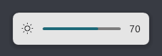

<div align="center">

```text
███╗   ███╗  █████╗   ██████╗ ██╗  ██╗ ███████╗ ██╗   ██╗ ███████╗
████╗ ████║ ██╔══██╗ ██╔════╝ ██║ ██╔╝ ██╔════╝ ╚██╗ ██╔╝ ██╔════╝
██╔████╔██║ ███████║ ██║      █████╔╝  █████╗    ╚████╔╝  ███████╗
██║╚██╔╝██║ ██╔══██║ ██║      ██╔═██╗  ██╔══╝     ╚██╔╝   ╚════██║
██║ ╚═╝ ██║ ██║  ██║ ╚██████╗ ██║  ██╗ ███████╗    ██║    ███████║
╚═╝     ╚═╝ ╚═╝  ╚═╝  ╚═════╝ ╚═╝  ╚═╝ ╚══════╝    ╚═╝    ╚══════╝
```

### Use an Apple Magic Keyboard on Windows the way you use it on a Mac.

<kbd>⌘ C</kbd> <kbd>⌘ V</kbd> <kbd>⌘ Tab</kbd> <kbd>⌘ Space</kbd> <kbd>⌘ ⇧ 4</kbd> <kbd>⌥ ←</kbd> <kbd>F1</kbd> <kbd>F2</kbd>

<br>

[](#)
[](#-install)
[](https://github.com/microsoft/PowerToys)
[](LICENSE)

<br>

[**✨ Features**](#-features) &nbsp;•&nbsp;
[**🔆 Brightness**](#-brightness-that-feels-native) &nbsp;•&nbsp;
[**🚀 Install**](#-install) &nbsp;•&nbsp;
[**⚙️ How it works**](#️-how-it-works) &nbsp;•&nbsp;
[**🇹🇷 Türkçe**](#-türkçe)

<br>



<sub>The brightness overlay, styled after the Windows 11 volume flyout.</sub>

</div>

---

MacKeys makes **Command work like Command**, brings back the Mac shortcuts you have in muscle memory, and makes the brightness keys work on **every** screen. That includes external monitors, and the screen under the mouse is the one that changes, just like macOS. It switches itself **on when the Magic Keyboard connects and off when it disconnects**, so your laptop keyboard stays a normal Windows keyboard.

```text
                ┌──────┐ ┌──────┐ ┌──────┐ ┌────────┐ ┌────────────────────┐ ┌────────┐ ┌──────┐
 Magic Keyboard │  fn  │ │ ctrl │ │ opt  │ │  cmd   │ │       space        │ │  cmd   │ │ opt  │
                └──────┘ └──────┘ └──────┘ └────────┘ └────────────────────┘ └────────┘ └──────┘
 Windows gets       –       Win      Alt      Ctrl                              Ctrl       Alt
```

## ✨ Features

### ⌨️ Keys
| Magic Keyboard key | Acts as |
|---|---|
| <kbd>⌘ Command</kbd> (left and right) | <kbd>Ctrl</kbd>, so <kbd>⌘C</kbd> / <kbd>⌘V</kbd> / <kbd>⌘Z</kbd> / <kbd>⌘S</kbd> / <kbd>⌘T</kbd> / <kbd>⌘W</kbd> … all work like on a Mac |
| <kbd>⌃ Control</kbd> | <kbd>Win</kbd> |
| <kbd>⌥ Option</kbd> | <kbd>Alt</kbd> |

### 🧭 Shortcuts
| Shortcut | What it does |
|---|---|
| <kbd>⌘ Tab</kbd> / <kbd>⌘ ⇧ Tab</kbd> | Switch apps |
| <kbd>⌃ Tab</kbd> | Switch browser tabs |
| <kbd>⌘ Space</kbd> | Search (like Spotlight) |
| <kbd>⌘ Q</kbd> | Quit the app |
| <kbd>⌘ ←</kbd> / <kbd>⌘ →</kbd> | Start / end of line (add <kbd>⇧</kbd> to select) |
| <kbd>⌘ ↑</kbd> / <kbd>⌘ ↓</kbd> | Top / bottom of the document (add <kbd>⇧</kbd> to select) |
| <kbd>⌥ ←</kbd> / <kbd>⌥ →</kbd> | Previous / next word (add <kbd>⇧</kbd> to select) |
| <kbd>⌥ ⌫</kbd> | Delete the previous word |
| <kbd>⌘ [</kbd> / <kbd>⌘ ]</kbd> | Browser back / forward (<kbd>⌘ Ğ</kbd> / <kbd>⌘ Ü</kbd> on a Turkish layout) |
| <kbd>⌘ ⇧ 3</kbd> | Screenshot of the whole screen, saved to *Pictures\Screenshots* |
| <kbd>⌘ ⇧ 4</kbd> | Screenshot of a selected area |
| <kbd>⌘ ⇧ 5</kbd> | Screen recording (Snipping Tool) |
| <kbd>⌃ ⌘ Q</kbd> | Lock screen |

### 🎛️ Top row
| Key | What it does |
|---|---|
| <kbd>F1</kbd> / <kbd>F2</kbd> | 🔅 / 🔆 Brightness down / up for **the screen under the mouse**, with an on-screen overlay |
| <kbd>F7</kbd> / <kbd>F8</kbd> / <kbd>F9</kbd> | ⏮ / ⏯ / ⏭ Previous / Play-Pause / Next |
| <kbd>F10</kbd> / <kbd>F11</kbd> / <kbd>F12</kbd> | 🔇 / 🔉 / 🔊 Mute / Volume down / Volume up |
| <kbd>F3</kbd>–<kbd>F6</kbd> | Normal F-keys (F5 refresh still works) |

### 🔆 Brightness that feels native
- **External monitors** use DDC/CI, the same thing as pressing the monitor's own buttons. The **laptop panel** uses the standard Windows (WMI) brightness.
- The overlay copies the Windows 11 volume flyout. It slides up from the taskbar (280 ms ease-out), updates in place while you keep pressing, and slides away 2 s after the last press. It also follows light/dark mode, your accent color and per-monitor DPI.
- It appears instantly. Brightness values are cached and refreshed in the background, and all monitor I/O runs on a worker thread so the animation never stutters.

### 🔌 Only when you're using the Magic Keyboard
By default, MacKeys switches everything **on when an Apple keyboard is connected** (Bluetooth or USB) and **off when it isn't**. When it's off, your laptop's own keyboard behaves like a normal Windows keyboard. You get a small notification each time it switches.

Right-click the ☀️ icon in the tray to change this:

| Tray option | |
|---|---|
| **Automatic** | On while an Apple keyboard is connected (default) |
| **Always on** / **Off** | Manual control |
| **⌘L goes to apps** | Optional, see below |
| **Start with Windows** | |

### 🔒 ⌘L
On a Magic Keyboard, ⌘ is the Win key, and Windows handles **Win+L (lock screen) before any app or remapper can see it**. So by default ⌘L locks the screen instead of jumping to the address bar.

If you turn on **⌘L goes to apps** in the tray menu, MacKeys turns off Win+L *only while Mac keys are active* and turns it back on when they switch off or MacKeys exits. ⌃⌘Q still locks the screen. Windows asks for administrator permission once the first time you enable it, because this is a system policy (`DisableLockWorkstation`).

## 🚀 Install

> **Requirements:** Windows 10/11 and [PowerToys](https://learn.microsoft.com/windows/powertoys/install), which you can install with `winget install Microsoft.PowerToys`.

```powershell
git clone https://github.com/yaylaerkan/MacKeys.git
cd MacKeys
powershell -ExecutionPolicy Bypass -File .\install.ps1
```

The installer does the following:
- 🔨 Builds `MacKeys.exe` with the C# compiler that ships with Windows. No Visual Studio is needed.
- 📦 Installs it to `%LOCALAPPDATA%\MacKeys` and starts it with Windows, for the current user only.
- ⌨️ Applies the shortcut config to PowerToys. **Your original Keyboard Manager config is backed up first** (`default.json.before-mackeys`).

> [!TIP]
> Only want the brightness keys? Run `install.ps1 -SkipPowerToys`.

### 🧹 Uninstall

```powershell
powershell -ExecutionPolicy Bypass -File .\uninstall.ps1 -RestorePowerToys
```

### 🛠️ Build

```powershell
.\build.ps1          # -> bin\MacKeys.exe
```

Or open `src\MacKeys.csproj` in Visual Studio.

## ⚙️ How it works

```text
  Magic Keyboard ──► PowerToys Keyboard Manager ──► apps
                            ▲
                            │ Mac config / empty config + reload
                            │
                     MacKeys.exe (tray) ──► F1/F2 ──► DDC/CI (monitor) / WMI (laptop) ──► overlay
                            │
                            └──► watches for an Apple keyboard, ⌃⌘Q lock, optional ⌘L
```

MacKeys has two parts:

1. **[PowerToys](https://github.com/microsoft/PowerToys) Keyboard Manager** handles the key and shortcut remapping. The config is [`config/keyboard-manager.json`](config/keyboard-manager.json).
2. **`MacKeys.exe`** is a tiny (~20 MB RAM) background app. It is one C# file, [`src/MacKeys.cs`](src/MacKeys.cs), with no dependencies beyond .NET Framework 4.x, which ships with Windows. It does three jobs:
   - It handles the brightness keys and the overlay.
   - It watches for an Apple keyboard (vendor id `05AC` over USB, `004C` over Bluetooth). It switches PowerToys between the Mac config and an empty one, and asks Keyboard Manager to reload, so no restart is needed.
   - It handles ⌃⌘Q (`MacKeys.exe --lock`) and the optional ⌘L setting.

## ⚠️ Known limitations
- Windows cannot see the Magic Keyboard's <kbd>fn</kbd> key, so the media/brightness actions replace F1, F2 and F7–F12 while Mac keys are active. Shortcuts that rely on those F-keys, such as F2 rename, F11 full screen and F12 DevTools, are not available during that time.
- While an Apple keyboard is connected, the remapping also applies to any other keyboard you type on at the same time. Windows remappers can't tell keyboards apart.
- ⌘L locks the screen unless you enable **⌘L goes to apps** (see above).
- PowerToys remaps don't apply inside apps running as administrator unless PowerToys also runs elevated. The brightness keys work everywhere.
- External monitor brightness requires **DDC/CI** to be enabled in the monitor's own menu. Most monitors have it on by default.

## 📄 License

[MIT](LICENSE) © Erkan Yayla

---

## 🇹🇷 Türkçe

**Apple Magic Keyboard'u Windows'ta Mac'teki gibi kullanın.**

MacKeys şunları yapar:
- Command tuşu Mac'teki gibi çalışır (<kbd>⌘C</kbd>, <kbd>⌘V</kbd>, <kbd>⌘Tab</kbd>, <kbd>⌘Q</kbd>, <kbd>⌘Space</kbd>…).
- Mac'teki ekran görüntüsü kısayolları gelir: <kbd>⌘⇧3</kbd> tüm ekran, <kbd>⌘⇧4</kbd> seçili alan, <kbd>⌘⇧5</kbd> ekran kaydı.
- <kbd>⌃⌘Q</kbd> ekranı kilitler.
- <kbd>⌘←</kbd>/<kbd>⌘→</kbd> imleci satırın başına/sonuna, <kbd>⌘↑</kbd>/<kbd>⌘↓</kbd> belgenin başına/sonuna götürür. <kbd>⇧</kbd> ile birlikte basınca metni seçer.
- <kbd>⌥←</kbd>/<kbd>⌥→</kbd> kelime kelime gider (<kbd>⇧</kbd> ile seçer), <kbd>⌥⌫</kbd> önceki kelimeyi siler.
- <kbd>⌘Ğ</kbd>/<kbd>⌘Ü</kbd> tarayıcıda geri/ileri gider. Bunlar Mac'teki ⌘[ / ⌘] kısayollarının Türkçe klavyedeki karşılığı.
- Üst sıradaki tuşlar çalışır:
  - <kbd>F1</kbd>/<kbd>F2</kbd> mouse hangi ekrandaysa onun parlaklığını değiştirir (harici monitör dahil) ve Windows 11'in ses göstergesine benzeyen bir gösterge çıkar.
  - <kbd>F7</kbd>–<kbd>F9</kbd> müzik kontrolü, <kbd>F10</kbd>–<kbd>F12</kbd> ses.
- **Sadece Magic Keyboard bağlıyken çalışır.** Klavye bağlanınca tüm Mac kısayolları kendiliğinden açılır, bağlantı kopunca kapanır. Laptopun kendi klavyesi o zaman normal Windows klavyesi gibi davranır. İsterseniz tepsideki ☀️ simgesinden "Always on" veya "Off" seçerek elle de yönetebilirsiniz.
- **⌘L:** Windows, Win+L kısayolunu (ekran kilidi) her şeyden önce yakalar. Bu yüzden normalde ⌘L ekranı kilitler. Tepsi menüsünde "⌘L goes to apps" seçeneğini açarsanız, Mac modu açıkken Win+L kapatılır ve ⌘L Chrome'da adres çubuğuna gider. Ekranı kilitlemek için ⌃⌘Q kullanırsınız. Bu seçeneği ilk açışta Windows bir kez yönetici izni ister.

**Kurulum:** Önce [PowerToys](https://learn.microsoft.com/windows/powertoys/install)'u kurun (`winget install Microsoft.PowerToys`), sonra:

```powershell
git clone https://github.com/yaylaerkan/MacKeys.git
cd MacKeys
powershell -ExecutionPolicy Bypass -File .\install.ps1
```

Kurulum PowerToys'taki mevcut Keyboard Manager ayarlarınızın yedeğini alır (`default.json.before-mackeys`). Kaldırmak için:

```powershell
powershell -ExecutionPolicy Bypass -File .\uninstall.ps1 -RestorePowerToys
```

Görev çubuğundaki güneş simgesine sağ tıklayarak uygulamanın Windows ile başlamasını açıp kapatabilir ya da uygulamadan çıkabilirsiniz.

<div align="center">
<br>
<sub>Made with ⌘ on Windows</sub>
</div>
